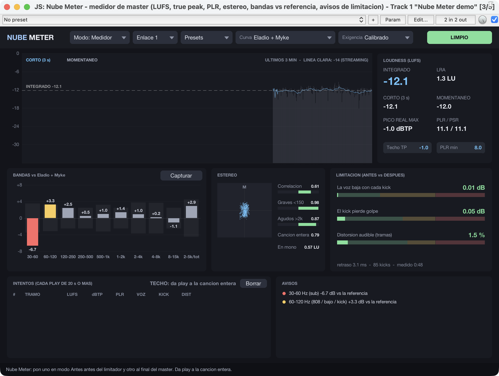

<!-- en -->
# Nube Meter

A free master meter for [REAPER](https://www.reaper.fm), written as a JSFX (macOS / Windows / Linux), part of the
[Nube plugins](https://github.com/KevinMeneses/nube-plugins).



BS.1770 loudness (integrated / short-term / momentary LUFS, LRA), 4x true peak, PLR/PSR, stereo correlation (total and
per band) with a vectorscope, tonal balance in 9 bands against a reference song, and a **limiting check**: a second
instance placed before the limiter lets the meter compare before vs after and tell you when the master starts to
hurt the song (vocal ducking on every kick, lost kick punch, audible distortion), with thresholds calibrated by ear.
It never touches the audio. 16 presets. ~3 % CPU (≈5.5 % with the before/after analysis).

**Install** — with [ReaPack](https://reapack.com): *Extensions → ReaPack → Import repositories*, paste
`https://github.com/KevinMeneses/nube-plugins/raw/main/index.xml`, then install **Nube Meter**. Or copy `nube_meter.jsfx`
into `REAPER/Effects/Nube Meter/` (on macOS `./install.sh` links it). It shows up as **JS: Nube Meter**. The interface is in Spanish.

**How it was made** — designed and built with [Claude Code](https://claude.com/claude-code). Since an AI can't
listen, every measurement is checked against a numpy model (`tests/proto.py`), which is in turn checked against the
offline analysis tools it replaces, by rendering test cases inside REAPER (`tests/run.sh`).

**License** — GPL-3.0-or-later (see `LICENSE`).

---

## Español
Medidor de master para REAPER (JSFX), hermano de [Nube Limit](https://github.com/KevinMeneses/nube-limit) y los
demás Nube. Junta en tiempo real lo que medían `claude_probe.jsfx` y las herramientas `analisis.py` y `techo.py`.


- **Loudness BS.1770**: integrado, corto (3 s), momentáneo y LRA, con historial de 3 minutos. Mismo código que Nube Limit
  (±0.02 LU contra la norma).
- **Pico real 4x**, **PLR** (pico real − integrado) y **PSR** (pico de los últimos 3 s − corto).
- **Estéreo**: vectorscopio, correlación en vivo (total, graves < 150 Hz, agudos > 2 kHz), correlación de la canción
  entera y cuánto pierde en mono (LU).
- **Bandas contra una referencia**: las 9 bandas de `analisis.py` (30 Hz–15 kHz) relativas al LUFS integrado, o sea "a
  igual volumen", más 2–5 kHz sobre el total (la zona que cansa el oído). Curvas: Eladio + Myke (por defecto), Eladio,
  Myke, Sean Paul (dancehall), el master X20 de Nube baja, una **capturada** (pones cualquier canción, play y
  *Capturar*) o ninguna. Por encima de 15 kHz no se compara: las referencias vienen con pérdida.
- **Limitación (Antes vs Después)**: con un segundo Nube Meter en modo **Antes** justo antes del limitador/clipper, el
  Medidor se alinea solo con la latencia de la cadena y mide lo mismo que `techo.py`:
  - **la voz baja con cada kick** (1–4 kHz en los 30 ms después de cada kick, contra el resto),
  - **el kick pierde golpe** (40–150 Hz, primeros 40 ms sobre los primeros 300 ms),
  - **distorsión audible** (% de tramas con error sobre el umbral de enmascaramiento por tercio de octava).

  Veredicto **LIMPIO / AL LÍMITE / SE DAÑA** con los umbrales de lo que escuchaste en Nube baja (abajo).
- **Techo de la canción**: cada reproducción de 20 s o más queda en la tabla de intentos (LUFS, dBTP, PLR, voz, kick,
  distorsión, estado). El techo es el intento más fuerte que quedó LIMPIO. La meta depende de la canción, no de un número fijo.
- **Avisos** en palabras: qué pasó y qué tocar.

## Instalar

```sh
./install.sh
```

Crea un enlace en `~/Library/Application Support/REAPER/Effects/Nube Meter/`. En REAPER aparece como **JS: Nube Meter**.

## Cómo se usa

1. En el master: **Nube Meter (modo Antes)** justo antes del limitador o clipper (después del EQ y el glue).
2. **Nube Meter (modo Medidor)** al final del master, con el mismo **enlace** (1–4; usa otro si tienes dos masters abiertos).
3. Play a la canción entera. Sube el limitador y vuelve a darle play: cada intento queda en la tabla.

Sin la instancia Antes funciona igual (volumen, picos, estéreo, bandas), solo sin la parte de limitación.

| Acción | Cómo |
|---|---|
| Techo TP / PLR mínimo | Arrastra arriba/abajo o rueda; **Shift** = fino; **doble clic** = −1 dBTP / 8 |
| Curva, exigencia, modo, enlace | Menús de arriba |
| Reiniciar | Clic en el panel de loudness (o dar play) |
| Capturar referencia | Botón *Capturar* en el panel de bandas, con la canción de referencia sonando |

## Calibración

Umbrales de la limitación, sacados de los 5 masters de Nube baja que escuchaste (`tests/calib.py techo`, mismo premaster W71):

| Master (lo que dijiste) | LUFS | voz en kick | golpe del kick | distorsión | Nube Meter |
|---|---|---|---|---|---|
| W71, limitador −14.5 ("le gusta") | −11.8 | 0.26 dB | 0.34 dB | 3.0 % | LIMPIO |
| limitador −15 ("todavía bien") | −11.4 | 0.55 | 0.43 | 4.3 | AL LÍMITE |
| limitador −16 ("se empieza a dañar") | −10.8 | 0.91 | 0.50 | 8.0 | SE DAÑA |
| X1v ("suena muy bien") | −9.0 | 0.20 | 0.12 | 8.8 | LIMPIO |
| X1c ("se distorsiona un poco") | −8.5 | 0.30 | 0.15 | 12.0 | AL LÍMITE |

Limpio hasta / se daña desde: voz 0.35 / 0.80 dB, kick 0.40 / 0.60 dB, distorsión 10 / 14 %. **Exigencia**: Estricto
×0.75, Permisivo ×1.3. Estos números están a ±0.2 de los de `techo.py` (que conocía la cadena); Nube Meter no
necesita saber qué hay entre Antes y Medidor: estima la parte lineal de la cadena (FIR de 4096 coeficientes con el
espectro cruzado) y mide solo lo que no es lineal, así una rotación de fase o un EQ no cuentan como distorsión.

Bandas: tolerancia ±2.5 dB por banda (con la curva Eladio + Myke, la mitad de lo que difieren entre ellas + 1 dB);
2–5 kHz: +1 dB (+4.5 con Eladio + Myke). Correlación: aviso si queda 0.25 bajo la referencia o pierde más de 1 LU en mono.

## Presets

| Preset | Curva | Techo TP | PLR mín | Exigencia |
|---|---|---|---|---|
| Nube baja (calibrado) | Eladio + Myke | −1 | 8 | Calibrado |
| Streaming seguro (dinamico) | Eladio + Myke | −1 | 9 | Estricto |
| Trap / rap fuerte | Eladio | −1 | 7 | Permisivo |
| Drill / rage (muy fuerte) | Eladio | −0.5 | 6 | Permisivo |
| Reggaeton oscuro (mucho sub) | Myke | −1 | 8 | Calibrado |
| Dancehall | Sean Paul | −1 | 8 | Calibrado |
| Lo-fi / chill (dinamico) | Myke | −1 | 10 | Estricto |
| Comparar con Nube baja (X20) | Nube baja X20 | −1 | 8 | Calibrado |
| WhatsApp / auto (version fuerte) | Eladio + Myke | −1 | 7 | Permisivo |
| Club / DJ | Eladio + Myke | −0.3 | 6 | Permisivo |
| YouTube / podcast | Eladio + Myke | −1.5 | 10 | Estricto |
| Premaster (antes del master) | Eladio + Myke | −3 | 12 | Estricto |
| Stem / exportar | sin referencia | −1 | — | Calibrado |
| Referencia capturada | capturada | −1 | 8 | Calibrado |
| Solo picos y volumen | sin referencia | −1 | 8 | Calibrado |
| Por defecto | Eladio + Myke | −1 | 8 | Calibrado |

## Lecturas para scripts

Slider N = parámetro N−1 (`TrackFX_GetParam`), se leen después de renderizar:

| Slider | Lectura | Slider | Lectura |
|---|---|---|---|
| 1–3 | pico máx, RMS activo, bloques activos (como `claude_probe`) | 20 | voz en kick (dB) |
| 12 / 13 / 14 | LUFS integrado / corto / momentáneo | 21 | golpe del kick (dB) |
| 15 | pico real máx (dBTP) | 22 | distorsión (%) |
| 16 / 17 | PLR / LRA | 23 / 24 | banda más desviada / 2–5 kHz vs referencia |
| 18 / 19 | correlación / pérdida en mono (LU) | 25 | estado: −1 sin Antes, 0 limpio, 1 al límite, 2 se daña |
| 28–36 | cada banda vs la referencia | 26 / 27 | retraso Antes→Medidor (muestras) / kicks |
| 37 | 2–5 kHz sobre el total (dB) | 4 | Reiniciar (como el de `claude_probe`) |

## Pruebas

- `tests/calib.py` (numpy, sin REAPER): el modelo `tests/proto.py` contra `analisis.py` en los masters de Nube baja y las
  referencias (LUFS, pico real y PLR ±0.04, correlación exacta, mono ±0.01, 9 bandas ±0.01 dB, 2–5 kHz ±0.01) y contra
  `techo.py` en sus 5 casos de calibración (tabla de arriba). También calcula las curvas de referencia.
- `tests/run.sh`: 13 renders en un REAPER propio, **91 chequeos**:
  - el audio sale igual (diferencia < −180 dB; es el ruido antidenormales de REAPER) con Medidor, Antes, y con
    Antes → Nube Limit → Medidor contra Nube Limit solo;
  - LUFS, pico real, PLR, LRA, correlación, mono, las 9 bandas, 2–5 kHz y las lecturas de `claude_probe` contra el modelo
    (master X20, seno de −20 dB, ruido);
  - retraso medido = latencia real: 151 muestras (Nube Limit 3 ms), 247 (5 ms), 175 (Nube Clip 4x + Nube Limit), enlace 2;
  - voz en kick, golpe del kick, distorsión, kicks y estado contra el modelo (Nube Limit +12: limpio; +17 Agresivo:
    1.60 dB / 1.03 dB / 54.7 %, se daña); sin Antes o con enlace distinto: estado −1;
  - los 16 presets; y `tests/lint.py`: ningún nombre que difiera solo en mayúsculas (EEL2 no las distingue) ni
    variables o funciones compartidas entre la gráfica y el audio.
- `tests/ui_demo.lua`: abre la cadena con la ventana del Medidor (de ahí sale `docs/captura.png`).

Nota: las pruebas necesitan REAPER y Python con numpy, scipy y soundfile (`NUBE_PY=/ruta/a/python tests/run.sh`). Usan
grabaciones de Nube baja que no están en el repo (`tests/signals/`, `tests/make_signals.py`). `run.sh` abre su propio
REAPER (`-new`) y cierra solo ese proceso: `-nonewinst` mandaría el script al REAPER que tengas abierto.

## Detalles técnicos

- Enlace Antes → Medidor por `gmem` (anillo de 65536 muestras por enlace). El Antes corre antes en la cadena, así que su
  contador ya avanzó cuando el Medidor procesa el mismo bloque. La latencia de lo que hay en medio se mide con GCC-PHAT
  (35 tramas de 8192 con señal; confianza ≥ 0.2) y la parte lineal con un FIR de 4096 coef. que se recalcula cada ~1 s
  (convolución por solapar y sumar). Si cambias la latencia a mitad de canción, vuelve a dar play.
- Distorsión: igual que `master_sim.distorsion` (STFT 1024/512, tercios desde 25 Hz, enmascaramiento que se esparce
  −8 dB/banda hacia arriba y −16 hacia abajo, umbral −12 dB, solo las tramas sobre el percentil 20).
- Filtros pasa-banda: el mismo Butterworth de 8º orden de `scipy.signal.butter(4, [lo, hi], 'bandpass')`, diseñado dentro
  del JSFX (iguales a 1e-9 dB en cualquier frecuencia de muestreo).
- Bandas: FFT de 16384 cada 8192 con Hann y sin la media (= Welch de `analisis.py`).
